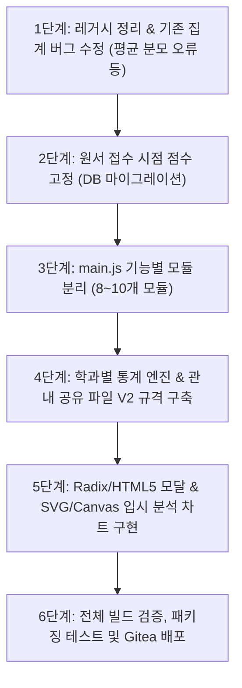

# 고입 결과 분석 및 프로그램 현대화 설계서 (확정안)

> 작성일: 2026-10-20 · 상태: **검토 완료 및 계획 확정**
> 기준 코드: Gitea `PHGC-OFFLINE` main `77e9c2c` (동기화 완료)

---

## 1. 목적

1. **원서 접수 시점 성적 기준의 학과별 정밀 분석**:
   - 고교에서 학교 전체 최저/최고/평균만 뭉뚱그려 공개하여 겪던 진학지도의 어려움을 해소합니다.
   - 원서 접수 시점의 점수 스냅샷을 기반으로 **마이스터고·특성화고의 "학과별" 실제 커트라인 및 지원 분포**를 정밀 집계합니다.
2. **울산 평준화 일반고 합격선 분석**:
   - 선발 인원 범위 내 합격 여부를 판정하며, 배정 학교가 아닌 **일반고 합격 가능 커트라인(내신 백분율 및 총점)**을 분석합니다.
3. **오프라인 관내 데이터 안전 취합**:
   - 학생 식별정보(이름, 학번 등)는 100% 배제하고, 익명 점수 데이터와 구간별 인원표를 관내 취합하여 표본의 신뢰도를 극대화합니다.
4. **코드 현대화 및 모듈화**:
   - 10,739줄에 달하는 단일 `main.js` 파일에서 미사용 구형 코드(Dead Code)를 정리하고 기능별 모듈로 분리합니다.
   - Radix/HTML5 기반의 깔끔한 모달 UX와 SVG/Canvas 벡터 차트를 도입하여 시각적 직관성을 대폭 강화합니다.

---

## 2. 핵심 확정 사항

| # | 항목 | 확정 내용 |
|---|---|---|
| 1 | 분석 단위 | **고교 × 전형(일반·특별·취업) × 학과별 집계** (학과별 커트라인 완전 공개) |
| 2 | 일반고 기준 | **"울산 평준화 일반고" 전체를 단일 합격선**으로 분석 (배정 학교는 배제) |
| 3 | 분석 단계 | **1차: 교과 성적(내신)** / **2차: 교과 + 출결 + 봉사 + 가산점 (서류 총점)** |
| 4 | 제외 요소 | 면접, 실기 등 정성평가 요소는 배제 (내장된 면접 20점 제외 서류 만점 기준 유지) |
| 5 | 판정 구간 정의 | **안정**(합격유력) / **적정**(경합) / **소신**(합·불 겹침구간) / **도전**(상향) |
| 6 | 데이터 보존성 | 프로그램 업데이트 시 SQLite 자동 마이그레이션 및 자동 역산으로 **기존 입력 자료 100% 계승 (재입력 불필요)** |
| 7 | 관내 공유 파일 | 표지에는 송신 중학교명 보존, 내부 점수 데이터에는 학교명 및 개인정보 배제 |
| 8 | UI/UX 현대화 | `main.js` 기능별 ES Modules 분리, 레거시 제거, Radix/HTML5 모달, SVG/Canvas 차트화 |

---

## 3. 원서 접수 시점 점수 고정 및 데이터베이스 구조

### 3-1. 점수 스냅샷 자동 고정 원칙
- 담임교사가 학생 지원 현황을 저장하는 순간, [calc_school.go](calc_school.go)와 [calc.go](calc.go)에서 산출된 **원서 접수 시점의 세부 점수(교과, 출결, 봉사, 가산점, 총점)**를 영구 고정합니다.
- 이후 2학기 말 성적이나 출결이 변동되더라도 지원 당시의 점수는 변형되지 않습니다.

### 3-2. 스냅샷 필드 구성
- **공통**: 전교 석차 백분율, 전과목 평균 성취도
- **마이스터고·특성화고**: 전과목 교과점수, 가중 교과점수, 출결 점수, 봉사 점수, 리더십/가산점, 서류 총점 (각 만점 포함)
- **일반계고**: 전교 석차백분율, 교과점수, 비교과점수, 일반고 총점 (200점 만점)
- **메타정보**: 적용 산출식 버전, 출결 기준일(9/30 또는 10/31)

---

## 4. 입시 지도용 4단계 판정 구간 (정의 바로잡음)

관내 누적 합격/불합격 표본 데이터를 기준으로 지원 대상 학과별 구간을 다음과 같이 정밀 판정합니다.

1. **안정 (합격 유력권)**:
   - 전년도 합격자 평균 및 불합격 최고점보다 여유 있게 높은 점수대
   - 큰 변수가 없는 한 합격 가능성이 매우 높은 구간
2. **적정 (경합권)**:
   - 합격자 중위권 ~ 하위 25% 수준으로 합격선 안쪽에 위치
   - 합격 가능성이 높으나 동점자 처리 및 비교과 변수에 유의해야 하는 구간
3. **소신 (경계 / 합·불 겹침구간)**:
   - 합격자 최저점과 불합격자 최고점 사이에 위치하여 **합격자와 불합격자가 함께 존재하는 구간**
   - 비교과 감점 여부 및 당해 연도 경쟁률에 따라 당락이 갈리는 위험 구간
4. **도전 (상향 지원권)**:
   - 전년도 관내 합격자 최저점 미만 구간

---

## 5. 프론트엔드 모듈화 및 UI 현대화 계획

### 5-1. 레거시(Dead Code) 정리
- `renderModeSelectScreen` (과거 모드 선택 카드 화면, 약 60줄) 삭제
- `renderAdminLoginScreen` (과거 관리자 단독 로그인 화면, 약 60줄) 삭제
- `renderSyncScreen` (과거 온라인 동기화 화면, 약 220줄) 삭제
- 미사용 유령 구조체(`ExpectedSupportSubmission` 등) 정리

### 5-2. `main.js` 모듈 분리 구조
```text
frontend/src/
├── main.js                  # [진입점] 라우팅 및 전역 이벤트 리스너 (~300줄)
├── core/
│   ├── state.js             # 전역 상태 (로그인 사용자, 학급 등)
│   ├── utils.js             # 공통 유틸 함수
│   └── dialogs.js           # Radix / HTML5 기반 시스템 모달 (Alert, Confirm)
├── views/
│   ├── auth/                # 로그인, 초기설정, 서약서
│   ├── admin/               # 학년부장 대시보드 및 일괄 병합
│   └── teacher/             # 담임교사 대시보드 및 학생 테이블
├── modals/
│   ├── studentConsultModal.js  # 1:1 심층 상담 모달
│   ├── applicationModal.js     # 고교/학과 지망 등록 모달
│   ├── matrixModal.js          # 신호등 매트릭스
│   └── guideModal.js           # 프로그램 사용 매뉴얼
├── charts/
│   ├── overlapChart.js      # 합·불 겹침 구간 SVG 히스토그램
│   └── trendLineChart.js    # 3개년 커트라인 Canvas/SVG 추세선
└── print/                   # A4 인쇄 엔진 및 서식 템플릿
```

---

## 6. 단계별 추진 로드맵



1. **1단계 (기반 정리)**: 미사용 레거시 제거 및 평균 분모 계산식 보정
2. **2단계 (점수 고정)**: 원서 접수 시점 세부 항목 스냅샷 저장 및 기존 DB 자동 역산
3. **3단계 (모듈화)**: `main.js`를 ES Modules로 분리하여 유지보수성 확보
4. **4단계 (분석 엔진)**: 마이스터/특성화 학과별 커트라인 및 일반고 합격선 통계 산출
5. **5단계 (UI 개편)**: Radix/HTML5 모달 리팩토링 및 합·불 겹침구간 SVG 차트 탑재
6. **6단계 (검증)**: 최종 `wails build` 및 Gitea 원격 백업
